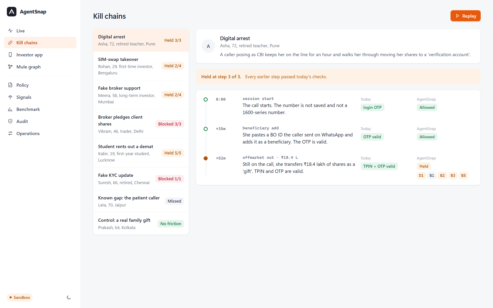
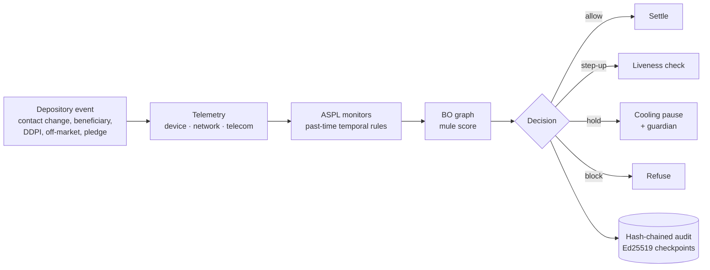
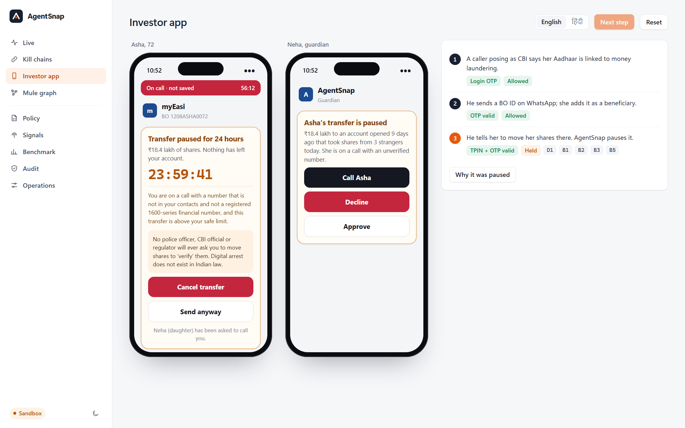
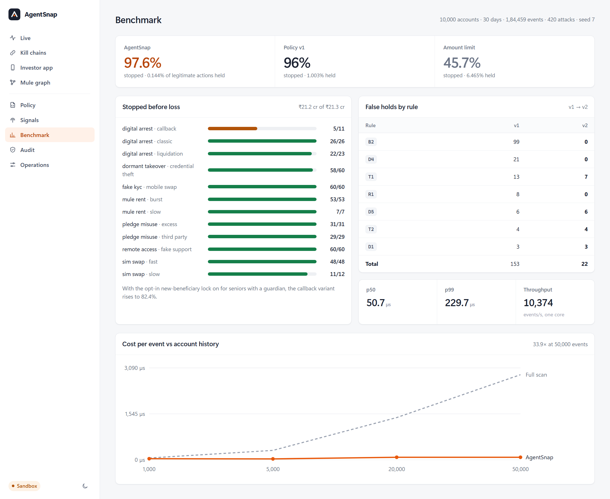

# AgentSnap

**A safety layer for the depository.** In an investment scam every step is properly authorised: the OTP is valid, the TPIN is valid. The sequence is the theft. AgentSnap checks every change to a demat account against investor-safety rules over the account's history, and pauses the sequences that are scams, with a family guardian in the loop.



Built for the CDSL Reimagine Ideathon 2026. Every account, number and event in this repository is synthetic.

| | |
|---|---|
| Attacks stopped before loss | **97.6%** of 420, across 7 kill chains and their evasive variants |
| Legitimate actions held | **0.144%** of 15,252 (a simple amount limit: 45.7% stopped, 6.5% held) |
| Cost per decision | p50 **51 µs**, p99 244 µs, one Python core, every layer on |
| Tests | **111**, including 60 randomised differential tests of the rule engine |

## How it works



- **Rules are a language, not a model.** ASPL expresses safety invariants with windows (`once`, `never`, `count`, `distinct`, `sum` over `[a, b]`) and `since`. Rules compile to monitors with a fixed amount of state per account, so a check costs the same on day 1 and day 1,000.

  ```
  rule D1 "Large transfer during an unverified call"
    on offmarket_out
    where value >= account.cap_offmarket
      and tel.call_active
      and tel.caller_class not in {contact, bfsi_1600}
    then hold 24h guardian
  ```

- **Telemetry from three places.** On the phone (call state, screen sharing, remote-control apps, hesitation; only yes/no values or scores leave the device). From the session (network class, impossible travel). From telecom feeds (TRAI 1600-series registry, DoT Financial Fraud Risk Indicator, DoT revoked numbers, CAMARA SIM Swap and Number Verification), queried by keyed hash.
- **The depository's own view.** Both legs of every off-market transfer and which accounts share a phone: accounts that collect from strangers and forward on stand out before any single broker or bank sees them.
- **Pause, do not punish.** Holds happen at the authorisation step, before an instruction exists. A guardian is asked to call. Every hold explains itself in English or Hindi.

## Run

```
pip install -r requirements.txt
python -m uvicorn backend.main:app --port 8740      # or run.bat
```

Open http://localhost:8740. No external services; works offline.

| View | What to try |
|---|---|
| Kill chains | Replay "Digital arrest". Click step 3 for the signals, the rules with their source, and the evidence. |
| Investor app | Next step three times, then switch to हिंदी. Decline as the guardian. |
| Policy | Misspell a field: the checker rejects it with the line. Deploy as shadow, then promote. |
| Operations | Snapshot, run traffic, recovery drill. Fail a telecom provider and watch decisions marked degraded. |
| Audit | "Rewrite history" recomputes every hash; the signed checkpoint still catches it. |

<p>


</p>

## Integration API

`/v1` is what a depository participant or broker app would call. API keys with roles (`ingest`, `analyst`, `admin`), strict schemas, idempotent ingest. OpenAPI at `/docs`.

```
curl -X POST "localhost:8740/v1/events?lang=hi" -H "X-API-Key: dev-key" -H "Content-Type: application/json" -d '{
  "event_id": "demo-1", "ts": 1790000000, "bo": "1208ASHA0072", "type": "offmarket_out",
  "attrs": {"target_bo": "1208MULE0001", "value": 1840000, "reason": "gift", "channel": "app"},
  "tel": {"call_active": true, "caller_h": "a1b2c3d4e5f60718", "call_secs": 1800}}'
```

The response carries the decision, the rules that fired, the investor message in the requested language, and the audit position. `dev-key` works only when `AGENTSNAP_API_KEYS` is unset.

## Reproduce the numbers

```
python -m pytest tests -q                       # 111 tests
python -m backend.bench                         # results/benchmark.json
python -m backend.bench --policy policies/history/v1.aspl --out results/benchmark-v1.json
python -m backend.bench --optin 1.0 --out results/benchmark-optin.json
python -m backend.microbench                    # cost vs history length
python -m backend.loadtest --clients 16         # against a running server
```

| Seed 7 · 10,000 accounts · 30 days · 184,459 events | AgentSnap | Policy v1 | Amount limit |
|---|---|---|---|
| Attacks stopped before loss | **97.6%** | 96.0% | 45.7% |
| Legitimate actions held | **0.144%** | 1.003% | 6.465% |
| False holds per 1,000 accounts a month | **2.0** | 14.1 | 91 |

- Compiled monitors against a full history scan: 84 µs vs 2,861 µs per event at 50,000 past events (34×), identical decisions.
- HTTP: 512 single events/s at p99 57 ms with 16 concurrent clients; about 2,300 events/s in batches of 100.
- Crash recovery: snapshot plus replay of 6,008 logged inputs in 1.1 s, identical state fingerprint.
- Known gap: a "patient caller" who has the victim hang up and send a small amount the next day is stopped 45% of the time. An opt-in new-beneficiary lock raises that to 82% for families who turn it on.
- The legitimate traffic includes the hard cases: gifts during calls with family, beneficiary IDs pasted from WhatsApp, VPN users, lost-phone SIM replacements, grandparents sending shares to a grandchild's new account.

## Production

[docs/PRODUCTION.md](docs/PRODUCTION.md) lists what is built and how each guarantee is tested: idempotent ingest, out-of-order events, fail-closed defaults, provider circuit breakers, crash recovery, signed audit, shadow-mode policy rollout, bounded memory, metrics and health checks.

[docs/GO_LIVE.md](docs/GO_LIVE.md) explains why each remaining go-live step exists (real traffic, telecom feeds, the cooling window, key custody, security and privacy review, the native SDK) and the workaround already built for it, with a threat model.

## Layout

```
backend/aspl.py        policy language: parser, static checker, incremental and reference monitors
backend/engine.py      pipeline, failure policy, shadow policies, holds, metrics, snapshot and replay
backend/api_v1.py      integration API, schemas, policy lifecycle, recovery drill, privacy export
backend/telemetry.py   device, network and telecom signals; circuit breakers; degraded modes
backend/feeds.py       1600 / FRI / MNRL file sync; CAMARA SIM Swap client
backend/graph.py       transfer and shared-device graph, mule score
backend/audit.py       hash chain, Ed25519 checkpoints, key rotation, witness log, input log
backend/sim.py         synthetic population, legitimate behaviour, 7 attack types
backend/scenarios.py   named kill-chain replays
backend/bench.py       benchmark (also microbench.py, loadtest.py, shadow_replay.py)
policies/              default.aspl (27 rules, English and Hindi); history/v1.aspl
frontend/              console, no build step, no CDN
sdk/                   web SDK; Android reference signals (not compiled here)
tests/                 language, semantics, differential, end-to-end, production, go-live, API
```

## Configuration

| Variable | Purpose |
|---|---|
| `AGENTSNAP_API_KEYS` | `name:key:role1+role2,...` |
| `AGENTSNAP_SIGNING_KEY`, `AGENTSNAP_KEY_PASSPHRASE` | Ed25519 key file for audit checkpoints, encrypted at rest |
| `AGENTSNAP_WITNESS` | Path where signed checkpoints are appended for external publication |
| `AGENTSNAP_FEEDS_DIR` | Directory with `1600.csv`, `fri.csv`, `mnrl.csv` |
| `AGENTSNAP_CAMARA_URL`, `_CLIENT_ID`, `_CLIENT_SECRET` | Operator SIM Swap endpoint |
| `AGENTSNAP_DATA` | Snapshots and runtime data |
| `AGENTSNAP_CONSOLE_OPEN=1` | Serve the console beyond localhost |
